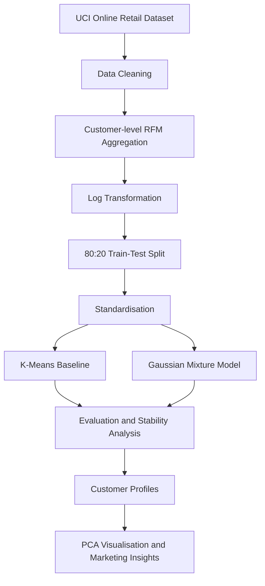

# Customer Segmentation from Transactions

**Identifying customer purchasing patterns using RFM features and unsupervised machine learning.**

**Headline result:** K-Means (K=2) achieved a held-out silhouette score of **0.4331** and Davies–Bouldin index of **0.8937**, outperforming the selected GMM configuration on both metrics.

**Course:** EC-417 — Introduction to Machine Intelligence  
**Project:** Project 11 — Customer Segmentation from Transactions  
**Institution:** National Institute of Technology Andhra Pradesh  
**Team:** [Nikhil Karn](https://github.com/nikhilkrn) (623151) and [Sumanth](https://github.com/Sumanth815) (623149)

---

## 1. Problem

Businesses that sell products to a large customer base need to understand differences in purchasing behaviour. Treating every customer identically can make marketing campaigns less relevant and reduce the effectiveness of customer engagement strategies.

The objective of this project is to apply unsupervised machine learning to transaction data and identify groups of customers with similar purchasing behaviour.

We formulate this as a **customer clustering problem** using three Recency, Frequency and Monetary (RFM) features:

- **Recency:** How recently a customer made a purchase.
- **Frequency:** How often a customer purchased, measured by distinct invoices.
- **Monetary:** Total retained purchase value.

Since the dataset does not contain ground-truth customer segment labels, this is an unsupervised learning problem. There is no conventional class balance or classification accuracy to report.

### Evaluation metrics

We use the following internal clustering metrics:

- **Silhouette Score:** Measures cluster cohesion and separation. Higher values are generally better.
- **Davies–Bouldin Index:** Measures similarity between clusters. Lower values are generally better.
- **Adjusted Rand Index (ARI):** Measures agreement between cluster assignments from different random initialisations. Higher values indicate greater assignment stability.

These metrics help evaluate clustering quality and stability without requiring labelled customer segments.

## 2. Data

### Dataset source

The project uses the **Online Retail** dataset from the UCI Machine Learning Repository.

Dataset: https://archive.ics.uci.edu/dataset/352/online+retail

- Dataset ID: 352
- Original format: Excel (`.xlsx`)
- Original records: 541,909 transactions
- Period: 1 December 2010 to 9 December 2011
- Original features: `InvoiceNo`, `StockCode`, `Description`, `Quantity`, `InvoiceDate`, `UnitPrice`, `CustomerID`, and `Country`.

**Dataset licence:** The dataset is licensed under a Creative Commons Attribution 4.0 International (CC BY 4.0) license. The original dataset is not included in this repository.

### Data cleaning

The following cleaning operations were performed:

1. Removed records with missing `CustomerID`.
2. Removed cancelled invoices whose invoice number starts with `C`.
3. Removed records with non-positive `UnitPrice`.
4. Removed records with non-positive `Quantity`.
5. Removed exact duplicate records.

| Cleaning stage | Remaining records |
|---|---:|
| Original dataset | 541,909 |
| After removing missing CustomerID | 406,829 |
| After removing cancelled invoices | 397,924 |
| After removing non-positive UnitPrice | 397,884 |
| After removing non-positive Quantity | 397,884 |
| After removing duplicates | 392,692 |

The final cleaned dataset contains **392,692 transactions and 4,338 unique customers**.

Missing product descriptions were retained where possible because a missing description does not necessarily invalidate a transaction.

Negative quantities and cancelled invoices were excluded. Consequently, Monetary represents retained positive-purchase value rather than net spending after returns and refunds.

### Customer-level feature construction

Transaction records were aggregated into one RFM record per customer.

- Recency was calculated using one day after the latest retained transaction as the reference date.
- Frequency was calculated as the number of distinct invoices per customer.
- Monetary was calculated as the sum of `Quantity × UnitPrice`, in pounds sterling.

### Class balance and split

There are no labelled classes in this dataset. Cluster proportions are reported after model training rather than treating them as ground-truth class balance.

The customer-level RFM dataset was split as follows:

| Dataset | Customers | Percentage |
|---|---:|---:|
| Training | 3,470 | 80% |
| Testing | 868 | 20% |
| Total | 4,338 | 100% |

The split uses `random_state=42`.

The RFM features were log-transformed using `log1p`. Standardisation was fitted only on the training data and then applied to the test data to avoid preprocessing leakage.

## 3. Method

### Workflow

The project follows this workflow:



### Baseline: K-Means

K-Means was selected as the baseline clustering algorithm.

The algorithm groups customers by minimising the within-cluster sum of squared distances.

We evaluated cluster counts from K=2 to K=10 using inertia and silhouette score.

The selected configuration was:

- Algorithm: K-Means
- Number of clusters: 2
- Random state: 42

K=2 achieved the highest silhouette score among the tested K-Means configurations.

### Alternative model: Gaussian Mixture Model

A Gaussian Mixture Model (GMM) was evaluated as an alternative to K-Means.

Unlike K-Means, GMM models clusters as probability distributions and can represent clusters with different shapes and covariance structures.

The following configurations were compared:

- Components: 2 to 10
- Covariance types: `full`, `tied`, `diag`, and `spherical`

The selected configuration was:

- Number of components: 10
- Covariance type: `full`

The selection was based on the lowest Bayesian Information Criterion (BIC) among the tested GMM configurations.

A lower BIC selects a configuration within the GMM candidate set. It does not establish that GMM performs better than K-Means.

### Improvement and evaluation

The main improvement over basic clustering was the use of RFM feature engineering, log transformation, training-only standardisation, and stability analysis.

Both models were evaluated on the same held-out test customers using the same internal clustering metrics.

Stability was measured using pairwise ARI comparisons across 10 random initialisations on the training data.

## 4. Results

### Model comparison

Held-out test results:

| Model | Configuration | Silhouette Score ↑ | Davies–Bouldin Index ↓ |
|---|---|---:|---:|
| K-Means | K=2 | **0.4331** | **0.8937** |
| GMM | 10 components, full covariance | 0.0842 | 2.3906 |

K-Means achieved a higher silhouette score and a lower Davies–Bouldin index than GMM.

### Stability comparison

| Model | Mean pairwise ARI | ARI standard deviation |
|---|---:|---:|
| K-Means | 1.0000 | 0.0000 |
| GMM | 0.8941 | 0.0571 |

K-Means produced identical assignments across the tested initialisations, while GMM showed some variation.

These are training-assignment stability results, not ten independent test evaluations.

### Customer segment profiles

The K-Means model identified two customer segments:

| Segment | Customers | Mean Recency (days) | Mean Frequency (invoices) | Mean Monetary (£) |
|---|---:|---:|---:|---:|
| Cluster 0 | 1,671 (38.5%) | 26.05 | 8.43 | 4,529.87 |
| Cluster 1 | 2,667 (61.5%) | 134.19 | 1.67 | 494.11 |

**Cluster 0 — Recently active, higher-value customers**

These customers have purchased more recently, placed more distinct invoices, and have higher retained purchase value on average.

**Cluster 1 — Less recent, lower-frequency customers**

These customers have a longer time since their last purchase, fewer distinct invoices, and lower retained purchase value on average.

### PCA visualisation

Principal Component Analysis (PCA) was used to project the three standardised RFM features into two dimensions for visual inspection.

- PC1 explains 75.11% of the variance.
- PC2 explains 18.74% of the variance.
- Combined variance explained: **93.85%**.

The visualisation is saved at:

`results/figures/kmeans_pca_clusters.png`

The PCA plot provides a visual summary of the clusters; it does not replace quantitative evaluation.

### Potential marketing recommendations

These recommendations are hypotheses based on the observed customer profiles, not experimentally validated business outcomes.

- **Cluster 0:** Consider loyalty rewards, early access, personalised recommendations, and retention-focused communication.
- **Cluster 1:** Consider re-engagement campaigns, relevant product recommendations, and carefully targeted incentives to encourage repeat purchases.

Any campaign should be evaluated before claiming that it improves business performance.

## 5. Error Analysis

The comparison shows that GMM did not separate the held-out customers as effectively as K-Means in this experiment.

Its silhouette score of 0.0842 indicates weak cluster separation compared with K-Means. Its Davies–Bouldin index of 2.3906 also indicates less favourable cluster compactness and separation.

Possible explanations include:

- The RFM data may be represented more effectively by distance-based K-Means clusters than by the selected Gaussian distributions.
- The 10-component full-covariance GMM may be unnecessarily complex for this feature space.
- Overlapping customer purchasing patterns may make probabilistic component assignments less distinct.

These are possible explanations, not confirmed causes. Further investigation of component covariance, posterior probabilities, and individual customer assignments would be needed to establish why GMM performed poorly.

The two-cluster K-Means result also simplifies customer behaviour. Customers near cluster boundaries may have similar purchasing patterns despite receiving different cluster labels.

The current analysis does not include a verified list of individual misclassified customers because there are no ground-truth segment labels against which to define classification errors.

## 6. Limitations and Ethics

### Dataset limitations

- The dataset covers a limited historical period from December 2010 to December 2011.
- Negative quantities and cancelled invoices were excluded, so returns and refunds are not reflected in Monetary.
- The dataset represents a particular online retail business and may not generalise to other industries or customer populations.
- The analysis uses only three RFM features and does not include customer demographics or other contextual information.

### Modelling limitations

- Clusters are exploratory groupings, not verified customer categories.
- Internal clustering metrics do not establish commercial value or improved marketing performance.
- The selected number of clusters depends on the feature representation and model-selection criteria.
- PCA reduces the feature space for visualisation and may hide details that are not captured by the first two components.

### Leakage risks

Preprocessing parameters must be learned from the training data only. The scaler is fitted on the training set and then applied to the held-out test set.

Any future feature selection, transformation, or dimensionality reduction used for model evaluation should follow the same principle.

### Ethical considerations

Customer segmentation can be used to personalise communication, but it should not be treated as a reliable measure of a customer's identity, financial condition, or personal characteristics.

The resulting clusters should not be used as the sole basis for decisions that could unfairly exclude or disadvantage customers. Any marketing use should respect applicable privacy requirements and be evaluated for unintended bias.

## 7. Reproduce

### Repository requirements

- Git
- Python compatible with the pinned dependencies in `requirements.txt`
- Internet access to download the UCI dataset
- VS Code or Jupyter Notebook (optional)

### Installation

Clone the repository:

```bash
git clone https://github.com/nikhilkrn/Customer-Segmentation-from-Transactions
cd Customer-Segmentation-from-Transactions
```

Create a virtual environment:

**Windows PowerShell**

```powershell
python -m venv .venv
.venv\Scripts\Activate.ps1
python -m pip install --upgrade pip
python -m pip install -r requirements.txt
```

**Windows Git Bash**

```bash
python -m venv .venv
source .venv/Scripts/activate
python -m pip install --upgrade pip
python -m pip install -r requirements.txt
```

### Download the dataset

```bash
python scripts/get_data.py
```

The script downloads the original Excel dataset to:

`data/raw/Online_Retail.xlsx`

### Generate the cleaned dataset and RFM features

Run the notebooks in this order:

1. `notebooks/01_dataExploration.ipynb`
2. `notebooks/02_rfm_analysis.ipynb`
3. `notebooks/03_customer_segmentation.ipynb`

The first notebook performs data exploration and cleaning. The second generates customer-level RFM features. The third performs clustering analysis and visualisation.

### Run the Python training pipeline

The current `src/train.py` expects the cleaned transaction CSV at:

`data/processed/online_retail_cleaned.csv`

After generating that file through the data-cleaning notebook, run:

```bash
python -m src.train
```

The pipeline generates model-selection results, evaluation metrics, stability results, customer profiles, and other outputs in the `results/` directory.

### Hardware

- Operating system: **Windows-11 Home 25H2**
- Processor: **i5-13450HX**
- RAM: **16GB**
- Python version: **3.14.8**


### Reproducibility note

The current workflow requires the notebook-based cleaning step before executing `python -m src.train`.

A single command that downloads the raw dataset, performs cleaning, trains the models, and regenerates every result has not yet been implemented and verified. Therefore, the workflow should not yet be described as a fully automated fresh-clone pipeline.

The raw dataset and serialized model checkpoints are not committed to the repository.

## 8. AI-Use Statement

AI assistance was used as a support tool during the project for clarifying machine-learning concepts, discussing implementation approaches, troubleshooting selected errors, and reviewing parts of the code and documentation. It also helped draft or refine some code sections and explanatory text.

## 9. References

1. Chen, D. (2015). *Online Retail* [Dataset]. UCI Machine Learning Repository. https://doi.org/10.24432/C5BW33


---

## 10. Repository Structure

```text
TermProject/
├── data/
│   ├── raw/                     # Downloaded source data (not committed)
│   ├── processed/               # Cleaned transaction data
│   └── README.md
├── notebooks/
│   ├── 01_dataExploration.ipynb
│   ├── 02_rfm_analysis.ipynb
│   └── 03_customer_segmentation.ipynb
├── results/
│   ├── figures/
│   ├── customer_rfm.csv
│   ├── customer_segments.csv
│   ├── cluster_profiles.csv
│   ├── kmeans_selection.csv
│   ├── gmm_selection.csv
│   ├── model_comparison.csv
│   ├── stability_results.csv
│   └── metrics.csv
├── scripts/
│   └── get_data.py
├── src/
│   ├── __init__.py
│   ├── data.py
│   ├── models.py
│   ├── evaluate.py
│   └── train.py
├── .gitignore
├── LICENSE
├── README.md
└── requirements.txt
```
